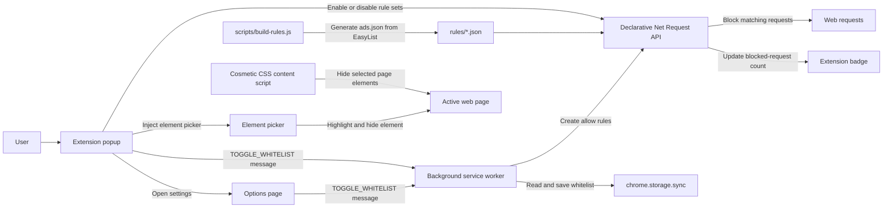

# NoNoise

NoNoise is a Manifest V3 browser extension for blocking ads, trackers, and common web annoyances. Its popup lets you toggle filtering rule sets, pause filtering for the current site, and hide an element on the current page. The options page manages the saved site whitelist.

## Features

- Toggle the ads, trackers, and annoyances rule sets.
- Pause or resume filtering for the current site.
- Hide a page element with the element picker.
- Manage whitelisted sites from the options page.
- Show the number of blocked requests on the extension badge.

## Architecture



## Project structure

```text
assets/                 Extension icons and font
rules/                  Static declarative network request rules
scripts/build-rules.js  Generates the ads rule list from EasyList
src/
  background/           Background service worker
  content/              Cosmetic CSS and element picker
  options/              Whitelist management page
  popup/                Filtering controls and site actions
  styles/               Shared page styles
manifest.json           Manifest V3 configuration
```

## Install for development

1. Clone this repository.
2. Open `chrome://extensions` in Chrome or a Chromium-based browser.
3. Enable **Developer mode**.
4. Select **Load unpacked** and choose the cloned project directory.

## Regenerate the ads rules

The rule generator fetches EasyList and writes the generated rules to `rules/ads.json`. Run it with Node.js:

```bash
node scripts/build-rules.js
```

The generated rules are capped at 5,000 entries.
