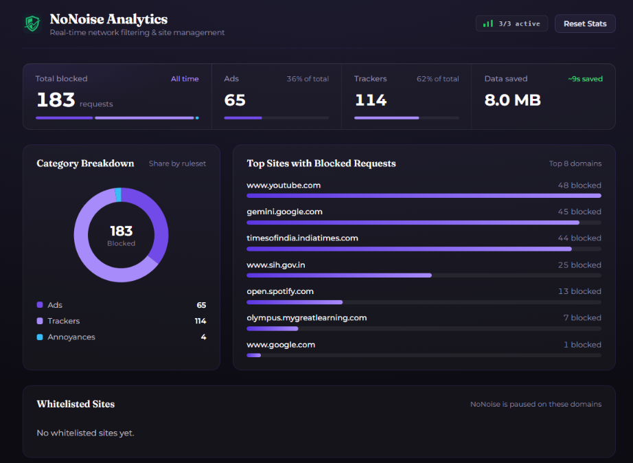
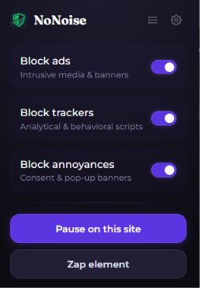
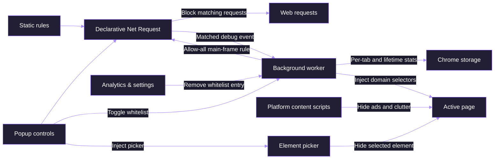

# NoNoise

NoNoise is a Manifest V3 browser extension that blocks ads, trackers, and web clutter for a faster, cleaner browsing experience.

The extension combines declarative network request rules with cosmetic filtering, per-site controls, element picking, and blocking analytics.


## Analytics dashboard



## Features

- **Three independent filter groups**
  - Ads
  - Trackers
  - Annoyances
- **Network filtering** powered by Chrome Declarative Net Request
- **Page clutter filtering** for domain-specific cosmetic rules
- **Platform-specific ad handling**
  - YouTube ad playback controls
  - Sponsored feed posts on Instagram, LinkedIn, X/Twitter, and Reddit
- **Per-site pause** with an allow-all dynamic rule for the selected domain
- **Zap element** tool to hide any page element temporarily
- **Blocked-request activity** for the current tab
- **Analytics dashboard**
  - Lifetime blocked-request totals
  - Ads, trackers, and annoyance breakdown
  - Estimated data and time savings
  - Top blocked domains
- **Whitelisted-site manager** in the options page
- **Extension badge** showing the number of blocked requests

## Filter stack

| Layer | What it stops | Powered by |
| :--- | :--- | :--- |
| **1. Network** | Ad servers, trackers, cookie scripts | [`scripts/build-rules.js`](./scripts/build-rules.js) → `rules/*.json` |
| **2. Cosmetic** | Empty ad containers & leftover boxes | [`src/background/service-worker.js`](./src/background/service-worker.js) |
| **3. Behavioral** | YouTube video ads & social "Sponsored" posts | [`src/content/youtube-ads.js`](./src/content/youtube-ads.js), [`src/content/social-ads.js`](./src/content/social-ads.js) |

## Popup

<p align="center">
  
</p>

Open the NoNoise icon in the Chrome toolbar to:

- Enable or disable Ads, Trackers, and Annoyances
- Pause or resume filtering on the current site
- Hide an element with **Zap element**
- View blocked requests for the current tab
- Open Analytics & Settings

## Analytics & Settings

The options page provides a dashboard for blocking activity and a list of paused sites. Blocked-request data is stored in `chrome.storage.local`; whitelisted domains are stored in `chrome.storage.sync`.

The data and time estimates are illustrative averages: the dashboard assumes approximately 45 KB and 0.05 seconds saved per matched block.

## Installation

### Load as an unpacked extension

1. Clone or download this repository.
2. Open `chrome://extensions` in Chrome or another Chromium-based browser.
3. Enable **Developer mode**.
4. Select **Load unpacked**.
5. Choose the repository root directory.

## Permissions

NoNoise requests the following permissions:

- `declarativeNetRequest` and `declarativeNetRequestFeedback` - Apply and observe filter rules
- `storage` - Store whitelist and analytics data
- `activeTab` - Identify the current tab and domain
- `scripting` - Inject cosmetic rules and the element picker
- `<all_urls>` host access - Apply filtering across visited websites

## Project structure

```text
assets/icons/                  Extension icons
assets/screenshots/            README screenshots
rules/
  ads.json                     Network rules for ads
  trackers.json                Network rules for trackers
  annoyances.json              Network rules for annoyances and popups
  cosmetic-rules.json          Domain-specific CSS selectors
scripts/build-rules.js         Downloads and converts filter-list sources
src/
  background/service-worker.js Dynamic whitelist, analytics, and cosmetic injection
  content/
    cosmetic-sync.js           Syncs cosmetic filtering state
    element-picker.js          Interactive element hiding tool
    social-ads.js              Social feed ad filtering
    youtube-ads.js             YouTube ad playback handling
  options/                     Analytics and whitelist dashboard
  popup/                       Main popup controls
  styles/                      Shared styles
manifest.json                  Manifest V3 configuration
```

## How it works



## Regenerate filter rules

The rule generator fetches EasyList and related source lists, extracts supported network rules and domain-specific cosmetic selectors, and writes the generated files in `rules/`.

Node.js is required:

```bash
node scripts/build-rules.js
```

The generator currently:

- Fetches ads, tracking, and annoyance sources
- Converts supported EasyList patterns into Declarative Net Request rules
- Writes domain-specific selectors to `rules/cosmetic-rules.json`
- Limits Ads to 15,000 rules
- Limits Trackers to 8,000 rules
- Limits Annoyances to 5,000 rules

Network access is required to regenerate the lists.

## Development notes

- NoNoise is written in plain HTML, CSS, and JavaScript with no build step.
- Reload the extension from `chrome://extensions` after source changes.
- Some cosmetic and platform-specific filters depend on selectors maintained by third-party filter sources or websites.
